<p align="center">
  
</p>

<h1 align="center">SplitNight</h1>

<p align="center"><strong>Split the bill, not the friendship.</strong><br />
Snap the receipt, say who had what, and let SplitNight do the maths — or let fate decide.</p>

<p align="center">
  <a href="https://github.com/UmitKayaardi/splitnight/actions/workflows/ci.yml"></a>
  <a href="LICENSE"></a>
  <a href="https://splitnight.vercel.app"></a>
</p>

## Live demo

**[splitnight.vercel.app](https://splitnight.vercel.app)** — tap **Try a sample receipt**. No upload, no sign-up, nothing to install. Works best on a phone, and can be installed to your home screen.

<!-- DEMO GIF: add docs/demo.gif here when it has been recorded -->

| Home                                            | Review items                                              | Say who had what                                            | Results                                               | Bill Roulette                                                |
| ----------------------------------------------- | --------------------------------------------------------- | ----------------------------------------------------------- | ----------------------------------------------------- | ------------------------------------------------------------ |
| 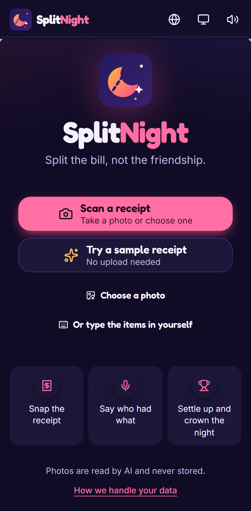         | 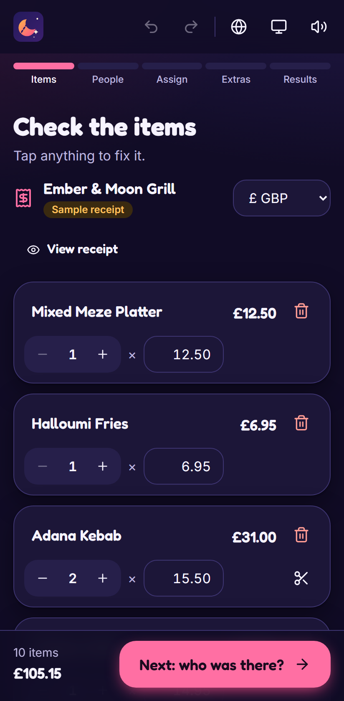         | 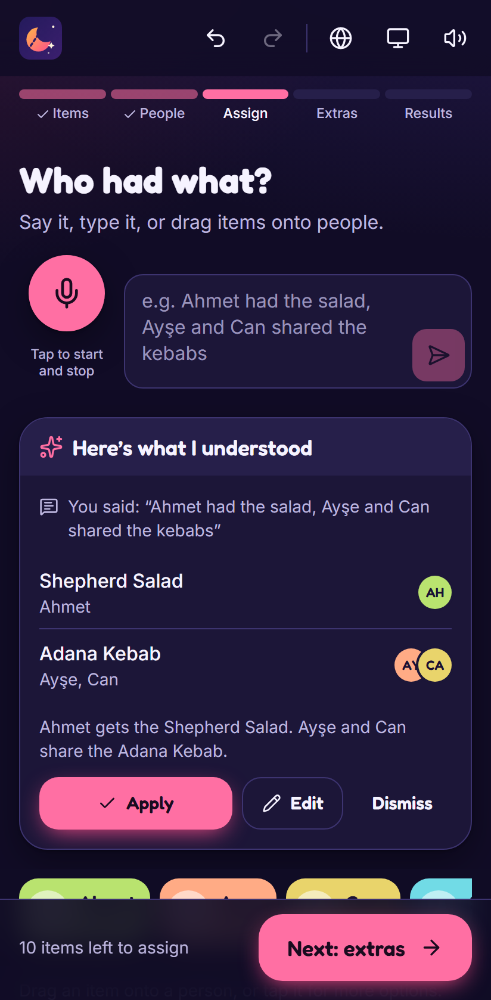 | 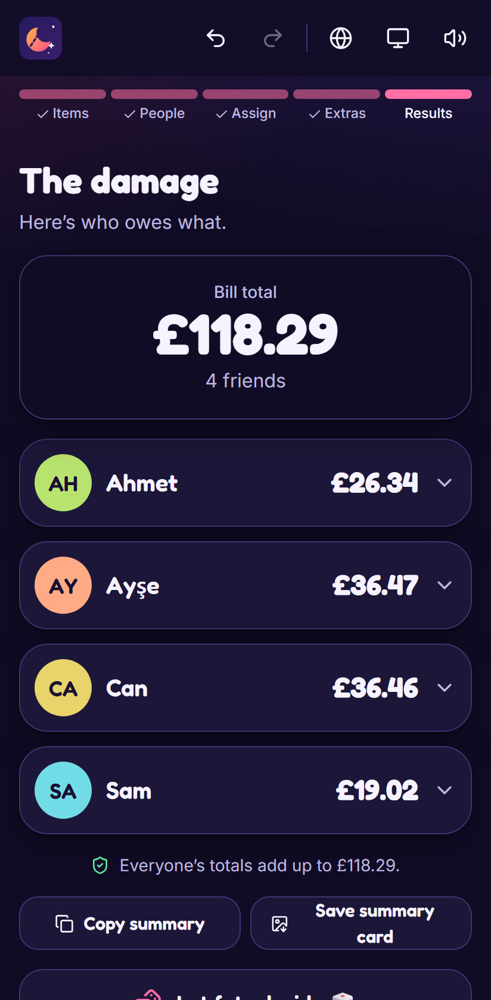         | 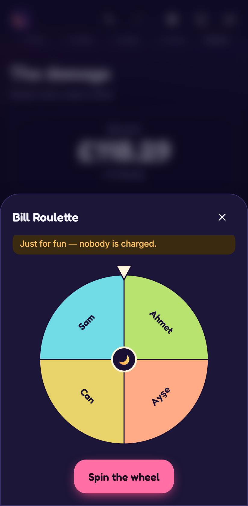   |
| 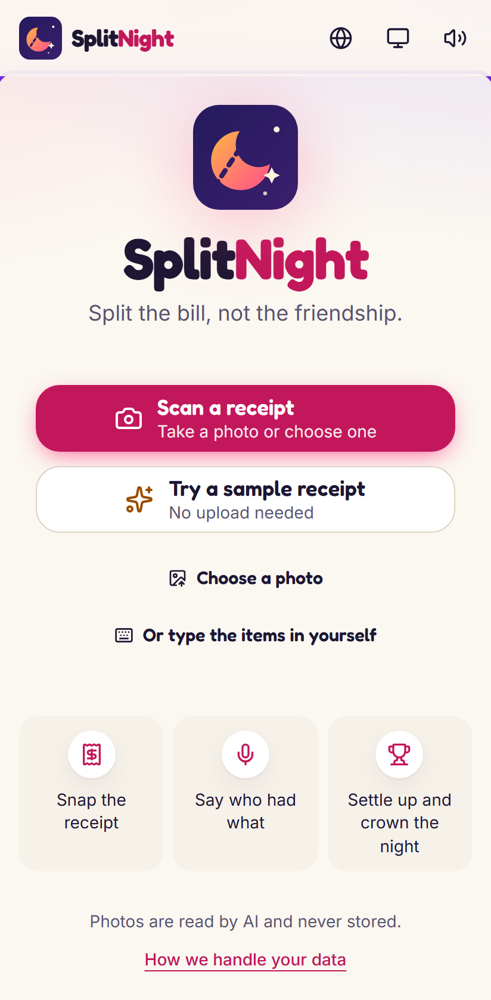 | 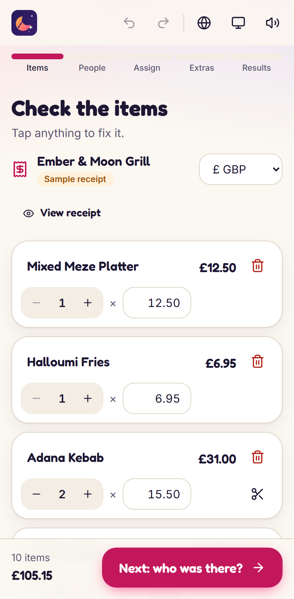 | 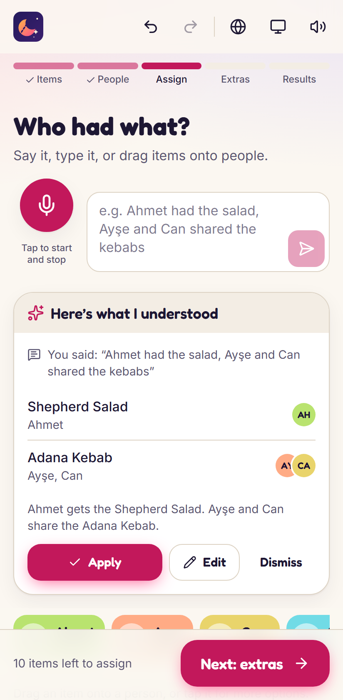         | 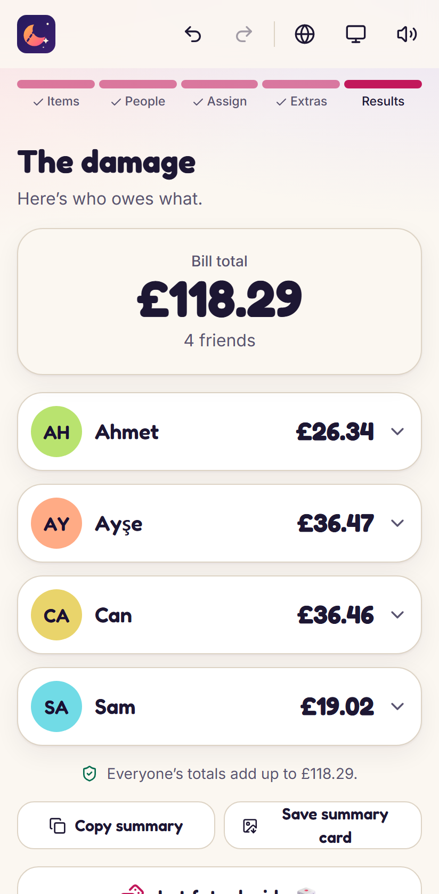 | 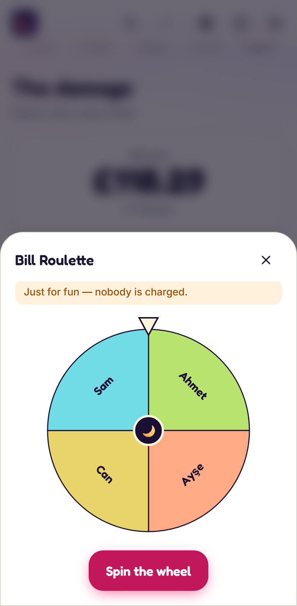 |

## Features

- **Scan** a receipt with the camera, a photo or drag and drop. AI reads items, quantities, prices, tax, service charge and discounts.
- **Fix anything inline.** Uncertain lines get a "Check this" chip, a banner warns when the totals don't match, and every change has undo/redo.
- **Say who had what** — _"Ahmet had the salad, Ayşe and Can shared the kebabs"_ — by voice or text, in English, Turkish, German, French or Spanish. You review a preview before anything changes.
- **Or do it by hand:** drag items onto people, or tap an item for a sheet with uneven shares and "everyone shared this". The whole app works without AI.
- **Extras:** service charge (the one on a UK receipt is used as-is), tip, discount, rounding to 10p/50p/£1, and currency.
- **Results** that always add up to the bill, per-person breakdowns, _titles of the night_ (Big Spender, Dessert Goblin, Kebab Royalty…), confetti, a copyable summary, a PNG summary card and native sharing.
- **Bill Roulette:** wheel, hidden cards, coin flip or dice, best of 3, three stakes. Fully undoable, and just for fun — nobody is charged.
- **Recent nights and Hall of Fame,** stored only on your device.
- Light/dark themes, installable PWA, accessible (keyboard and screen reader friendly, 44 px tap targets, reduced-motion support).

## How it works

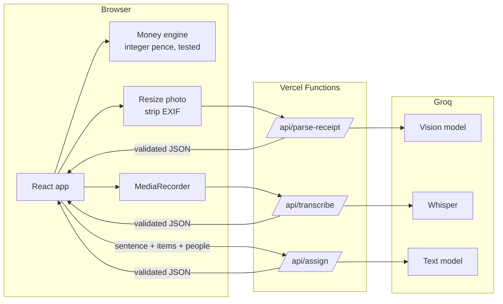

**AI never touches the arithmetic.** The models only read the receipt into structured data and map sentences to "who had which item". Every amount is then computed in plain, property-tested TypeScript using integer minor units, with the largest-remainder method, so everyone's total adds up to the bill to the penny.

More detail: [docs/ARCHITECTURE.md](docs/ARCHITECTURE.md).

## Accuracy

Measured with the app's own code paths. Full method and numbers: [docs/BENCHMARK.md](docs/BENCHMARK.md).

| Task                                                                   | Result               |
| ---------------------------------------------------------------------- | -------------------- |
| Receipt total read exactly right                                       | **12 / 12** receipts |
| Receipt items (name + exact price), F1                                 | **93.3 %**           |
| Sentences: every line assigned exactly right (English)                 | **59 / 60** (98.3 %) |
| Sentences: every line exactly right (Turkish, German, French, Spanish) | **40 / 40** (100 %)  |

Honest caveats:

- The receipt test set is small: **13 real photos**, most of them **not from UK restaurants** (US, Canadian and Australian supermarkets and restaurants, plus several UK ones). Some are deliberately blurry, dark or cropped.
- The ground truth was **labelled with AI assistance** (Claude Code read each photo and checked every receipt against its printed subtotal), then **spot-checked by the author**.
- The sentence cases are synthetic, with fictional menus and names (`benchmarks/assign-cases.json`): 60 English and 10 each in four other languages.
- **Voice is not benchmarked with audio files.** Speech-to-text is Groq's Whisper; the benchmark measures what happens once the words are known.
- To re-run: put photos in `test-receipts/` with a `ground-truth.json`, then `npm run benchmark:receipts` and `npm run benchmark:assign`.

## Privacy

- Receipt photos and voice recordings go to an AI service only so they can be read. SplitNight doesn't store or log them.
- No account, no tracking, no analytics, no ads.
- The bill lives in memory. Only preferences and short "recent night" summaries are kept, in your browser's `localStorage`, and "Clear my data" removes them.
- Photos are re-encoded in the browser before upload, which strips EXIF data such as GPS location.

## Tech stack

- **Frontend:** Vite, React 19, TypeScript (strict), Tailwind CSS 4, Framer Motion, dnd-kit, Zustand, react-i18next, Zod, canvas-confetti, html-to-image, vite-plugin-pwa, Fontsource (Fredoka, Inter).
- **Backend:** Vercel Functions (Node), the official `groq-sdk`, Zod.
- **AI models** (chosen from Groq's live model list on 2026-10-27, configurable by env var): `qwen/qwen3.8-27b` (vision, preview), `openai/gpt-oss-120b` (text), `whisper-large-v3` with `whisper-large-v3-turbo` fallback.
- **Quality:** Vitest and Testing Library, fast-check property tests, Playwright (phone viewport, API mocked, production CSP enforced), ESLint, Prettier, GitHub Actions.

## Run locally

Prerequisites: Node.js 20+ and a free Groq API key from [console.groq.com](https://console.groq.com/keys) (no card needed). Without a key, everything except the AI features still works.

```bash
npm install
```

```bash
copy .env.example .env
```

Then put your key in `.env` as `GROQ_API_KEY=...`. (On macOS/Linux use `cp` instead of `copy`.)

```bash
npm run dev
```

This runs the app _and_ the `/api` functions on [localhost:5173](http://localhost:5173). A small Vite plugin serves the functions, so you don't need a Vercel login.

Tests and checks:

```bash
npm run verify
```

```bash
npx playwright install chromium
```

```bash
npm run build && npm run e2e
```

Benchmarks (local only, they call Groq): `npm run benchmark:receipts` and `npm run benchmark:assign`.

## Deploy your own (free)

Uses the Vercel Hobby plan — no credit card. Install the [Vercel CLI](https://vercel.com/docs/cli) and log in, then:

```bash
vercel link
```

```bash
vercel env add GROQ_API_KEY production
```

```bash
vercel deploy --prod
```

Optional env vars `GROQ_VISION_MODEL`, `GROQ_TEXT_MODEL`, `GROQ_STT_MODEL` and `GROQ_STT_FALLBACK_MODEL` let you swap a deprecated model without changing code.

## Limitations

- Groq's free tier has per-minute and per-day limits. When they are hit, the app says the AI is busy and offers to retry, enter items by hand or use a sample receipt.
- The vision model is a **preview** model and may change or be retired; swap it with `GROQ_VISION_MODEL`.
- Translations other than English are machine-assisted.
- Voice accuracy has not been measured with recorded audio.
- AI can make mistakes. Check the items before settling up.

## Licence

[MIT](LICENSE) © 2026 Umit Kayaardi
