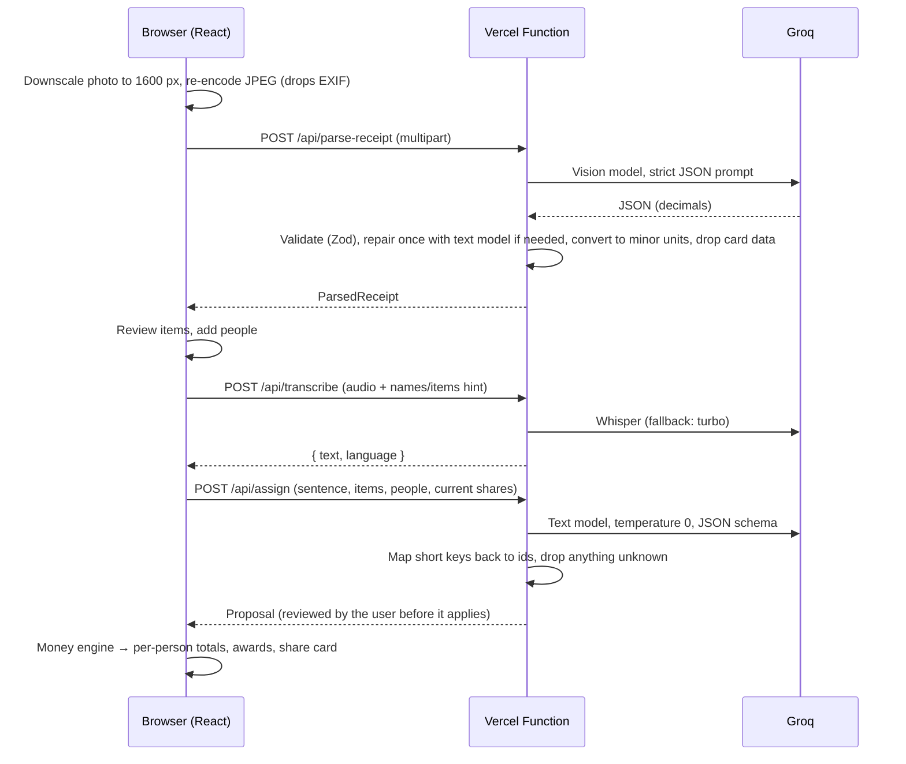

# Architecture

SplitNight is a single-page React app plus four small serverless functions in the same repository. The browser does all the money maths; the functions only talk to the AI.

## Folder structure

```
api/                 Vercel Functions (thin wrappers: export GET/POST → server/handlers)
server/              Function logic, testable without Vercel
  handlers.ts        HTTP concerns: same-origin check, flood guard, size/type checks, error mapping
  ai.ts              Seam over the Groq SDK (tests and CI swap in a fake)
  config.ts          Model names from env vars, timeouts, rate-limit settings
  errors.ts          { error: { code, message } } responses; upstream errors never leak
  rateLimit.ts       Best-effort per-IP sliding window
  receipt/           Vision prompt, lenient raw schema, normalisation to minor units, repair pass
  assign/            Sentence → assignment prompt (structured JSON output), id mapping and filtering
  speech/            Whisper call with vocabulary hint and model fallback
shared/schemas.ts    Zod schemas for every request and response (used by both sides)
src/
  lib/money/         The money engine (pure TypeScript, integer minor units)
  lib/assign/        Applies an AI proposal to the bill (including splitting lines)
  lib/awards.ts      "Titles of the night" — plain code, no AI
  lib/roulette.ts    Bill Roulette rules; lib/random.ts unbiased crypto randomness
  lib/recorder.ts    MediaRecorder wrapper with level meter and 60 s cap
  lib/image.ts       Client-side downscale + JPEG re-encode (strips EXIF/GPS)
  state/             Zustand stores: bill (with undo/redo), prefs, history, toasts
  features/          One folder per screen (home, scan, review, people, assign, extras, results, roulette…)
  i18n/              react-i18next; English bundled, other languages lazy-loaded
  samples/           Three fictional, pre-parsed UK receipts (+ SVGs in public/samples)
e2e/                 Playwright tests (API mocked) and the README screenshot script
scripts/             Secret check, benchmarks, sample/icon renderers
benchmarks/          Sentence-understanding dataset (receipt photos stay out of git)
```

## Data flow



The bill itself never leaves the browser. Photos and audio are sent only to be read and are not stored or logged; logs record only the error class and status.

## Money engine

All amounts are integers in minor units (pence, cents, kuruş). `computeSplit()` runs these steps:

1. **Items.** Each line total is split across its sharers by weight with the **largest-remainder method**: everyone gets `floor(total × weight / Σweights)`, and the leftover units go to the largest fractional remainders. Leftover pennies rotate by item position, so nobody always pays the extra penny. The parts always add up to the line total exactly.
2. **Discount.** A percentage or fixed amount of the item total (capped at the item total), shared in proportion to each person's item subtotal.
3. **Service and tip.** Based on the discounted total and shared in proportion to item subtotals. The tip can also be split equally. A service charge printed on a UK receipt is used as-is, so it is never added twice.
4. **Taxes printed on top** (e.g. US sales tax) are added in proportion. VAT that is already included in UK prices is informational only.
5. **Bill Roulette** (optional). Moves the chosen portion — everything, tip + service, or dessert items — from everyone else to the "winner", never making anyone negative.
6. **Rounding** (optional: 10, 50 or 100 minor units). Everyone rounds to the step. The difference goes to one person (by default whoever owes the most) so the grand total still matches. Rounding is skipped if it would make that person negative.

Percentages use basis points and half-up integer division, so there is no floating-point money anywhere. Property-based tests (fast-check) check, over random bills, that person totals always add up to the bill total, that nobody owes a negative amount, that every breakdown adds up to its own total, and that the result is deterministic.

## Assignment semantics

`/api/assign` returns entries `{ itemId, units?, shares[] }`:

- `shares` replaces the item's current sharers. Weights are relative (2:1 = two thirds/one third).
- `units` (optional) means only that many units of a multi-quantity line ("two of the three beers"). The client splits the line in two, assigns the split-off part, and leaves the remainder as it was.

The prompt shows the model short keys (`i1`, `p1`) instead of real ids. The server maps them back and drops anything that doesn't exist.

## Quality gates

- `npm run verify` runs the secret check, ESLint, `tsc` (app and node projects), Vitest and the production build.
- CI (GitHub Actions) runs the same steps plus Playwright against `vite preview`, which serves the production security headers. Tests fail on any CSP violation or uncaught page error. CI never calls Groq and needs no secrets.
- `npm run check:secrets` fails if a Groq key pattern or any file under `test-receipts/` is tracked.
